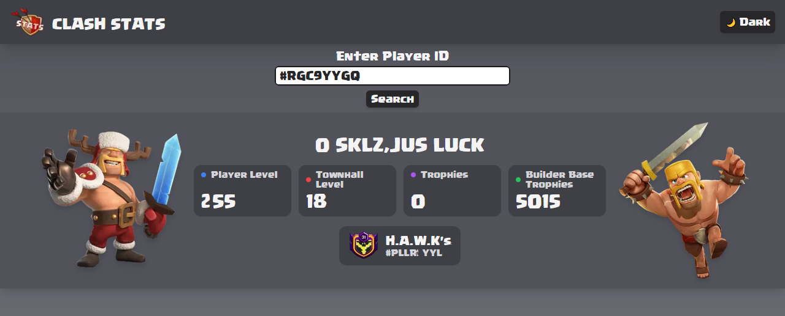

# Clash Stats

Look up any Clash of Clans player by their player tag and see their level, Town Hall, trophies and clan at a glance.



## Features

-   Player search by tag, e.g. `#RGC9YYGQ`
-   Player level, Town Hall level, trophies, Builder Base trophies and clan
-   Light and dark mode, remembered across visits
-   Responsive layout, built with WCAG 2.2 AA in mind

### Why the RoyaleAPI Proxy?

Clash of Clans API keys only work from whitelisted IP addresses. Vercel has no static IP, so the deployed app sends its requests through the free [RoyaleAPI proxy](https://docs.royaleapi.com/proxy.html), which has a fixed IP. In production `COC_API_BASE_URL` is set to `https://cocproxy.royaleapi.dev/v1` and the API key is created for the IP `45.79.218.79`.

Locally you can use the official API directly with a key for your own IP.

## Tests

```bash
npm test             # Jest unit tests
npx cypress open     # Cypress e2e tests, requires npm run dev
```

## License

[MIT](LICENSE)
